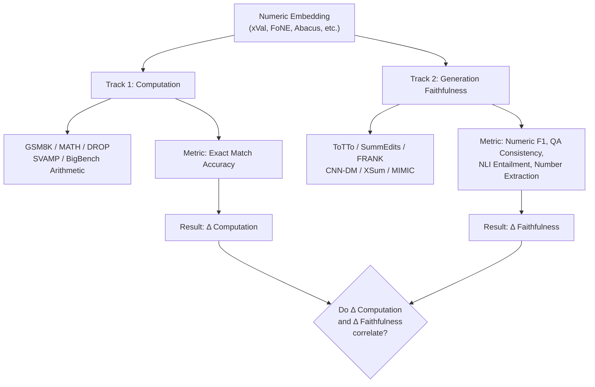

# Numerical Embeddings vs. Numeric Generation Faithfulness
## Research Overview for ACL/EMNLP-Style Project

---

## 1. Problem Summary

Standard subword tokenizers (BPE, SentencePiece) fragment numbers into arbitrary pieces — e.g., `12345` → `["12", "345"]` — destroying magnitude, ordering, and algebraic relationships. A growing body of work proposes **structured numerical embeddings** that encode numbers as continuous, mathematically meaningful vectors. These approaches demonstrably improve **numeric computation** (arithmetic accuracy, comparison, magnitude estimation).

However, a critical gap remains unexplored: **does improved numeric computation transfer to improved numeric faithfulness in generation?** A model that achieves 100 % on addition benchmarks may still hallucinate, distort, or copy the wrong number when summarizing a clinical report or generating text from a table. This project studies that gap.

> [!IMPORTANT]
> The core hypothesis: **Numeric computation ≠ Numeric generation faithfulness.** Better number embeddings are necessary but may not be sufficient for faithful numeric generation, because generation also depends on attention-based copying, context grounding, and decoding strategy.

### Key Distinctions

| Concept | Definition | Example Task |
|---|---|---|
| **Numeric computation** | Correctly performing arithmetic operations | "What is 347 + 928?" → 1275 |
| **Numeric reasoning** | Multi-step inference involving numbers | "If a train travels 60 mph for 2.5 hours, how far?" |
| **Numeric factual fidelity** | Preserving source numbers accurately in generated text | Summarize: "Revenue was $4.2B" → output must say $4.2B |
| **Numeric hallucination** | Generating unsupported or incorrect numbers | Source says "12 patients" → summary says "20 patients" |

---

## 2. Related Papers on Numerical Embeddings

### 2.1 Continuous Numerical Tokenization

#### xVal: Continuous Number Encoding for LLMs
- **Core idea:** Represents any real number as a single `[NUM]` token whose learned embedding vector is scaled by the actual numerical value, making the model end-to-end continuous over numbers.
- **Representation type:** Single-token continuous value-scaled embedding.
- **Target domain:** Scientific text, physics datasets.
- **Code available:** Yes — [GitHub (Polymathic-AI)](https://github.com/PolymathicAI/xVal).
- **Model public:** Pretrained models released for scientific domains.
- **Embedding category:** Continuous numeric tokenization.
- **Reproducibility:** ✅ Code + model both public.

> [!TIP]
> xVal is one of the strongest candidates for this project because it has public code, public models, and directly replaces tokenization — making it testable on both computation and generation tasks.

---

#### NumGPT: Improving Numeracy Ability of Generative Pre-trained Models
- **Core idea:** Encodes numbers using a prototype-based numeral embedding that separates mantissa and exponent. Includes a numeral-aware loss function during pretraining.
- **Representation type:** Prototype-based mantissa-exponent embedding.
- **Target domain:** General numeric reasoning (magnitude classification, comparison, math word problems).
- **Code available:** Limited; no well-maintained public repo found.
- **Model public:** No public model checkpoint.
- **Embedding category:** Value-aware embedding (prototype-based).
- **Reproducibility:** ⚠️ Paper describes method but no readily available code/model. Would need re-implementation.

---

### 2.2 Fourier / Sinusoidal Numeric Embeddings

#### FoNE: Precise Single-Token Number Embeddings via Fourier Features
- **Core idea:** Maps each number to a single token using pairs of sine/cosine functions at different periods (one pair per digit of precision). Achieves 100 % accuracy on large-scale addition, subtraction, and multiplication.
- **Representation type:** Fourier feature embedding (sin/cos at varying frequencies).
- **Target domain:** Arithmetic (addition, subtraction, multiplication).
- **Code available:** Yes — [GitHub (AIF4S/FNE)](https://github.com/AIF4S/FNE); [project page](https://fouriernumber.github.io/).
- **Model public:** Training code is public; pretrained checkpoints available for arithmetic tasks.
- **Embedding category:** Fourier/sinusoidal encoding.
- **Reproducibility:** ✅ Code public; models can be reproduced from training scripts.

---

#### Fourier Features in Pretrained LLMs (Mechanistic Interpretability)
- **Core idea:** Shows that pretrained LLMs naturally learn internal Fourier-like features for number representation — MLP layers use low-frequency features for magnitude approximation while attention layers use high-frequency features for modular arithmetic.
- **Representation type:** Emergent Fourier features (analysis, not a proposed method).
- **Target domain:** Mechanistic interpretability of arithmetic in transformers.
- **Code available:** Analysis code available in associated papers.
- **Model public:** Uses existing pretrained LLMs (GPT-2, Llama, etc.).
- **Embedding category:** Fourier/sinusoidal (emergent, not designed).
- **Reproducibility:** ✅ Reproducible analysis on public models.

---

### 2.3 Wavelet-Based Numeric Embeddings

#### MWNE: Multi-Wavelet Number Embedding
- **Core idea:** Uses wavelet decomposition to encode numerical values at multiple scales, capturing both coarse magnitude and fine-grained precision. Designed to bridge the modality gap when adapting LLMs for time-series forecasting.
- **Representation type:** Multi-scale wavelet decomposition of numeric values.
- **Target domain:** Time-series forecasting with LLMs.
- **Code available:** Limited availability; check OpenReview supplementary materials.
- **Model public:** No widely available public checkpoint.
- **Embedding category:** Wavelet encoding.
- **Reproducibility:** ⚠️ Method described in paper; may require re-implementation.

---

### 2.4 Positional / Structural Digit Embeddings

#### Abacus Embeddings ("Transformers Can Do Arithmetic with the Right Embeddings")
- **Core idea:** Provides each digit with an explicit positional embedding relative to the start of its number (units, tens, hundreds, …), mimicking an abacus. Combined with input injection and recurrent layers, achieves ~99 % accuracy on 100-digit addition when trained only on 20-digit problems.
- **Representation type:** Digit-positional embedding (per-digit position within number).
- **Target domain:** Arithmetic, length generalization.
- **Code available:** Yes — [GitHub (mcleish7/arithmetic)](https://github.com/mcleish7/arithmetic).
- **Model public:** Training code public; no pretrained LLM checkpoint (small experimental transformers).
- **Embedding category:** Structural digit embedding.
- **Reproducibility:** ✅ Code public; small-scale models trainable from scratch.

---

### 2.5 Value-Aware / Magnitude-Aware Embeddings

#### DICE: Deterministic, Independent-of-Corpus Embeddings
- **Core idea:** Creates number embeddings where cosine similarity between two embedding vectors reflects the actual distance between the numbers on the number line. Deterministic (no training required).
- **Representation type:** Distance-preserving deterministic embedding.
- **Target domain:** General numeracy tasks (magnitude estimation, comparison).
- **Code available:** Yes — reference implementations exist.
- **Model public:** Embedding method is deterministic (no model to train).
- **Embedding category:** Value-aware embedding.
- **Reproducibility:** ✅ Fully deterministic, easy to reproduce.

---

#### NumerSense: Probing Numerical Commonsense Knowledge
- **Core idea:** Not an embedding method per se, but a probing benchmark that tests whether LLMs encode numerical commonsense (e.g., "a bird has [MASK] legs"). Used to evaluate whether models have implicit numeric representations.
- **Representation type:** Probing task (evaluates existing representations).
- **Target domain:** Numerical commonsense.
- **Code available:** Yes — [HuggingFace](https://huggingface.co/datasets/numersense).
- **Model public:** Uses existing pretrained models.
- **Embedding category:** Evaluation benchmark (not an embedding method).
- **Reproducibility:** ✅ Public dataset and evaluation code.

---

### 2.6 Algebraic / Field-Isomorphic Representations

#### Neural Isomorphic Fields (NIF)
- **Core idea:** Creates fixed-length number embeddings that are algebraically isomorphic to the field of rational numbers — meaning addition, multiplication, and comparison in the embedding space correspond directly to the same operations on rational numbers.
- **Representation type:** Algebraic field-isomorphic embedding.
- **Target domain:** General arithmetic and algebraic reasoning.
- **Code available:** Check arXiv supplementary (early 2026 paper).
- **Model public:** No widely available public model.
- **Embedding category:** Symbolic/algebraic numeric representation.
- **Reproducibility:** ⚠️ Recent paper; code availability may be limited.

---

### 2.7 Digit-Level Tokenization Approaches

#### Individual Digit Tokenization (Various Papers)
- **Core idea:** Treat each digit (0–9) as its own token, plus decimal point and sign. Eliminates the inconsistent chunking problem of BPE. Used in several math-focused models.
- **Representation type:** Character-level digit tokenization.
- **Target domain:** Arithmetic, math reasoning.
- **Code available:** Trivial to implement by modifying any tokenizer.
- **Model public:** Several models use this (e.g., some Llama variants).
- **Embedding category:** Single-digit tokenization.
- **Reproducibility:** ✅ Trivially implementable.

---

#### Number Cookbook (Survey & Benchmark, 2025)
- **Core idea:** Comprehensive survey and benchmark framework (NUPA) for evaluating numerical understanding and processing in LLMs. Catalogues failure modes and tokenization effects.
- **Representation type:** Survey and evaluation framework.
- **Target domain:** General numerical understanding.
- **Code available:** Benchmark code available.
- **Model public:** Evaluates existing models.
- **Embedding category:** Meta-analysis / benchmark.
- **Reproducibility:** ✅ Public benchmark.

---

### Summary Table: Numerical Embedding Methods

| Method | Type | Domain | Code | Model | Can Reproduce? |
|---|---|---|---|---|---|
| **xVal** | Continuous value-scaled | Scientific text | ✅ Public | ✅ Public | ✅ Yes |
| **FoNE** | Fourier sin/cos features | Arithmetic | ✅ Public | ✅ Trainable | ✅ Yes |
| **Abacus Embeddings** | Digit-positional | Arithmetic | ✅ Public | ⚠️ Small models | ✅ Yes |
| **DICE** | Distance-preserving | Numeracy | ✅ Public | N/A (deterministic) | ✅ Yes |
| **NumGPT** | Prototype mantissa-exponent | General numeric | ⚠️ Limited | ❌ Not public | ⚠️ Re-implement |
| **MWNE** | Multi-wavelet | Time series | ⚠️ Limited | ❌ Not public | ⚠️ Re-implement |
| **NIF** | Field-isomorphic | Algebraic | ⚠️ Recent | ❌ Not public | ⚠️ Re-implement |
| **Digit-level tokenization** | Per-digit tokens | Arithmetic | ✅ Trivial | ✅ Many models | ✅ Yes |
| **Number Cookbook** | Benchmark/survey | Evaluation | ✅ Public | N/A (eval framework) | ✅ Yes |

---

## 3. Dataset Requirements by Task Type

### 3A. Datasets for Numeric Computation

#### What the dataset should contain
- **Pure arithmetic problems:** Addition, subtraction, multiplication, division of integers and decimals at varying scales (2-digit to 20+-digit).
- **Multi-step arithmetic:** Chained operations (e.g., "compute (34 × 12) + 57 − 19").
- **Comparison and ordering:** "Which is larger: 0.089 or 0.12?", sorting lists of numbers.
- **Rounding and magnitude:** "Round 3.14159 to 2 decimal places", "What order of magnitude is 4,700,000?".
- **Word problems:** Natural-language arithmetic where the answer is a specific number (e.g., GSM8K-style problems).

#### How to evaluate
- **Exact match accuracy** for deterministic answers.
- **Tolerance-based accuracy** (within ε) for floating-point or approximate answers.
- **Per-operation breakdown** to isolate which operations benefit from better embeddings.
- **Length generalization** tests (train on N-digit, test on M-digit where M > N).

#### Why it is relevant
These tasks isolate the **encoding problem**: does the model's internal number representation allow correct computation? This is the necessary (but potentially not sufficient) condition for faithful numeric generation.

#### Failure modes exposed
- Digit-level errors (carrying, borrowing).
- Magnitude confusion (confusing 10³ with 10⁶).
- Tokenization artifacts (BPE splits causing inconsistent digit grouping).
- Length generalization failure (works on small numbers, fails on large).

---

### 3B. Datasets for Numeric Factual Generation

#### What the dataset should contain

**Summarization with numbers:**
- Source documents containing specific numeric values (financial figures, counts, dates, percentages, measurements).
- Reference summaries that correctly preserve those numbers.
- Annotated error categories: number swap, magnitude shift, unit error, count error, date error, percentage hallucination.

**Clinical / biomedical summaries:**
- Discharge summaries, radiology reports, or clinical trial descriptions containing lab values, dosages, vital signs, durations.
- Gold-standard summaries with annotated numeric entities.

**Table-to-text generation:**
- Structured tables (sports statistics, financial data, scientific measurements) paired with faithful textual descriptions.
- Tests whether models correctly read, compare, and verbalize numbers from structured input.

**Long-form generation:**
- Multi-paragraph outputs where numbers from the input must be accurately copied, aggregated, or compared.
- Tests attention-based number copying over long contexts.

#### How to evaluate

| Metric | What It Measures |
|---|---|
| **Number extraction + exact match** | Extract all numbers from source and output; compute precision/recall of correct numbers |
| **QA-based consistency** (SummaQA, QAGS) | Generate numeric questions from source, check if model's summary answers match |
| **NLI-based entailment** (SummaC, AlignScore) | Does the source entail the numeric claims in the generated text? |
| **Number-swap detection** | Automatically swap numbers in reference summaries; test whether model/metric detects the error |
| **Human annotation** | Domain experts annotate numeric errors in generated summaries (gold standard) |
| **Numeric-specific F1** | Precision/recall specifically on numeric tokens |

#### Why it is relevant
This directly tests the **generation faithfulness** hypothesis: even if a model computes correctly in isolation, it may fail to faithfully reproduce numbers during generation because:
1. **Attention fragmentation:** The model may attend to the wrong source span when copying numbers.
2. **Decoding interference:** Beam search or sampling may prefer a "more likely" number over the correct one.
3. **Context contamination:** Surrounding text may bias the model toward hallucinating a contextually plausible but incorrect number.
4. **Aggregation errors:** When the model must compute over source numbers (e.g., "total revenue"), it may combine them incorrectly.

#### Failure modes exposed
- **Wrong copy:** Source says "12 patients" → summary says "15 patients".
- **Magnitude distortion:** Source says "$4.2 million" → summary says "$4.2 billion".
- **Unit error:** Source says "120 mg" → summary says "120 mL".
- **Date/temporal error:** Source says "March 2024" → summary says "March 2023".
- **Percentage hallucination:** Source says "a 3% increase" → summary says "a 30% increase".
- **Count fabrication:** Source lists 5 items → summary says "seven key factors".
- **Rounding/precision loss:** Source says "3.14159" → summary says "approximately 3".

---

### Why a Model May Excel at Arithmetic but Fail at Generation

> [!WARNING]
> **Arithmetic and generation are fundamentally different tasks.** Arithmetic is a closed-form computation: given an input, produce a deterministic output. Generation is an open-ended, context-dependent process where the model must decide *what* to say, *how* to say it, and *which* information to include — all while maintaining factual fidelity.

Specific reasons for the gap:

1. **Different attention patterns:** Arithmetic requires focused local attention on operands. Generation requires global attention across a long document, where numbers compete with non-numeric content for attention bandwidth.

2. **Decoding dynamics:** In arithmetic, the model typically uses greedy decoding with a clear right answer. In generation, sampling/beam search introduces stochasticity — a numerically correct token may have lower probability than a contextually plausible but incorrect one.

3. **Training distribution:** Math pretraining data has explicit numeric supervision. Summarization training data may not explicitly penalize numeric errors (ROUGE doesn't distinguish "12" from "21").

4. **Copy vs. compute:** Generation often requires *copying* numbers verbatim from the source, which is an attention-alignment problem, not an arithmetic problem. Better embeddings help computation but may not fix copy attention.

5. **Compositionality:** Summaries often require combining information (e.g., "total of X and Y"), which requires both correct computation *and* correct attribution — a conjunction that arithmetic benchmarks don't test.

---

## 4. Current Public Datasets

### 4A. Numeric Computation Benchmarks

| Dataset | Task Type | What It Measures | Why Useful | Category | Limitations |
|---|---|---|---|---|---|
| **GSM8K** | Grade-school math word problems | Multi-step arithmetic reasoning in natural language | Tests whether numeric embeddings improve word problem solving | Computation + reasoning | Relatively easy for modern LLMs; saturating |
| **MATH** | Competition-level math | Advanced math reasoning (algebra, geometry, calculus, number theory) | Tests deep numeric reasoning beyond basic arithmetic | Computation + reasoning | May be too hard to isolate embedding effects from reasoning |
| **DROP** | Discrete reasoning over paragraphs | Addition, counting, sorting, comparison over reading passages | Tests numeric computation *in context* of natural language | Computation + reading comprehension | Requires both comprehension and arithmetic; hard to disentangle |
| **SVAMP** | Robust arithmetic word problems | Arithmetic robustness against structural variations | Exposes reliance on shallow heuristics vs. true numeric understanding | Computation (robustness) | Elementary-level problems only |
| **MAWPS** | Arithmetic word problems | Basic arithmetic (+, −, ×, ÷) in word problem form | Standardized testbed for math word problem solving | Computation | Models can solve many via shallow heuristics |
| **BigBench - Arithmetic** | Pure arithmetic | Direct arithmetic computation (addition, subtraction, etc.) | Isolates pure computation without language complexity | Computation | Synthetic; may not reflect real-world numeric challenges |
| **Number Cookbook (NUPA)** | Comprehensive numeracy | Numeracy understanding and processing across many subtasks | Systematic evaluation of tokenization effects on numeric skills | Computation + understanding | Evaluation framework, not a single dataset |
| **NumerSense** | Numeric commonsense probing | Whether LLMs know common numeric facts (e.g., dogs have 4 legs) | Tests implicit numeric knowledge; useful as a sanity check | Understanding | Not about computation; tests knowledge not arithmetic |
| **Abacus Addition Sets** | N-digit addition | Length generalization in addition | Directly tests whether embeddings enable generalization | Computation | Synthetic; addition only |

---

### 4B. Numeric Generation / Factuality Benchmarks

| Dataset | Task Type | What It Measures | Why Useful | Category | Limitations |
|---|---|---|---|---|---|
| **SummEdits** | Inconsistency detection in summaries (10 domains) | Whether models detect factual edits (including number swaps) | Directly includes "number swap" as an error category | Generation faithfulness | Detection task, not generation task |
| **FRANK** | Factuality evaluation (CNN/DM, XSum) | Fine-grained factual error typology in generated summaries | Categorizes errors including numeric inaccuracies | Generation faithfulness | Annotations cover broad error types; numeric errors are a subset |
| **HaluEval** | Hallucination detection | Whether models can identify hallucinated content in summaries | Tests numeric hallucination detection capability | Generation faithfulness | Focuses on detection, not on preventing hallucination during generation |
| **ToTTo** | Controlled table-to-text generation | Whether generated text is faithful to highlighted table cells | Tests numeric copying from structured data to text | Generation faithfulness | Controlled setting may not capture real-world generation complexity |
| **DART** | Open-domain data-to-text | Factual consistency across diverse structured inputs | Tests numeric fidelity in multi-source generation | Generation faithfulness | Broad scope; numeric-specific evaluation requires custom metrics |
| **LogicNLG** | Logical table-to-text generation | Whether generated text follows logical/numerical inference from tables | Tests numeric reasoning + faithful generation from tables | Generation faithfulness + computation | Requires inference, not just copying |
| **HiTab** | Hierarchical table understanding | Numeric reasoning over complex, hierarchical tables | Tests numeric computation + generation from complex structured data | Computation + generation | Complex tables; hard to isolate embedding effects |
| **CNN/DailyMail** | News summarization | General summarization quality (with numeric content) | Widely used; can be filtered for number-heavy articles | Generation (general) | ROUGE doesn't capture numeric accuracy; need custom metrics |
| **XSum** | Extreme abstractive summarization | High compression summarization; frequent hallucination | Stress-tests numeric faithfulness under high compression | Generation (stress test) | High hallucination rate makes it noisy |
| **MIMIC-IV-Note** | Clinical discharge summarization | Faithfulness of clinical summaries (lab values, dosages, vitals) | High-stakes domain where numeric accuracy is critical | Generation faithfulness (clinical) | Requires data use agreement; domain expertise needed for evaluation |
| **MIMIC-CXR** | Radiology report summarization | Numeric accuracy in radiology findings | Tests numeric fidelity in medical imaging reports | Generation faithfulness (clinical) | Limited to radiology domain; requires data use agreement |
| **FactCHD** | Fact-conflicting hallucination detection | Detects comparisons and operations involving numeric data | Tests whether models identify numeric-fact conflicts | Generation faithfulness | Detection only, not generation |
| **FACTS Grounding** | Grounded generation factuality | Whether generation stays faithful to provided grounding context | Tests numeric preservation in grounded generation tasks | Generation faithfulness | May not have fine-grained numeric error annotations |
| **TofuEval** | Topic-focused summarization evaluation | Faithfulness with intrinsic vs. extrinsic error distinction | Categorizes sources of numeric errors (from document vs. fabricated) | Generation faithfulness | Focused on dialogue/meeting summarization |
| **NumericNLG** | Numeric data-to-text | Generating text with accurate numeric content from data | Directly targets numeric generation accuracy | Generation faithfulness | Smaller scale; may need augmentation |
| **InfoLossQA** | Information loss in simplification | QA-based detection of dropped numeric details during text simplification | Tests whether numbers are preserved during text transformation | Generation faithfulness | Focused on simplification, not summarization |

---

## 5. Evaluation Design Recommendations

> [!CAUTION]
> **The central risk:** A paper could show that numeric embeddings improve GSM8K accuracy and then claim this helps generation — without ever testing generation. The evaluation must explicitly separate these two pathways.

### Recommended Two-Track Evaluation

### Specific Recommendations

1. **Use matched baselines.** For each embedding method, compare against the *same* base model with standard tokenization. The only variable should be the number representation.

2. **Evaluate on both tracks with the same model.** Don't train one model for arithmetic and another for summarization. The point is to test whether a single model with better numeric embeddings improves on *both*.

3. **Create a numeric-focused test split.** For summarization datasets (CNN/DM, XSum), filter for articles with ≥ 5 distinct numeric values. This creates a "number-dense" evaluation subset.

4. **Use numeric-specific metrics alongside standard ones.** Standard ROUGE will not catch numeric errors. Use:
   - **Numeric Token F1:** Extract all numbers from reference and candidate; compute F1.
   - **Number Extraction Precision/Recall:** Are the right numbers in the output?
   - **Magnitude Accuracy:** Is the order of magnitude correct even if exact value differs?

5. **Include ablations on decoding strategy.** Test whether greedy decoding vs. sampling vs. beam search affects numeric faithfulness differently across embedding methods.

6. **Test copy-heavy vs. compute-heavy generation.** Some generation tasks require copying numbers verbatim; others require computing (e.g., "total of X and Y"). Separate these to understand which mechanism benefits from better embeddings.

7. **Report error taxonomy.** For generation tasks, categorize errors by type (wrong copy, magnitude error, unit error, fabrication, rounding loss) and report rates for each.

### Priority Experiments

| Priority | Experiment | Computation Dataset | Generation Dataset | Why |
|---|---|---|---|---|
| 🟢 High | xVal vs. BPE baseline | GSM8K, SVAMP | ToTTo, CNN/DM (number-dense) | Most reproducible; public code+model |
| 🟢 High | FoNE vs. digit tokenization | BigBench Arithmetic, Abacus Addition | ToTTo, SummEdits | Tests whether Fourier features help generation |
| 🟡 Medium | Abacus embeddings on generation | MATH, DROP | XSum (number-dense) | Tests structural digit embeddings beyond arithmetic |
| 🟡 Medium | DICE embedding layer swap | NumerSense, GSM8K | CNN/DM, FRANK | Tests value-aware embeddings on both tracks |
| 🔴 Stretch | Re-implement NumGPT / NIF | GSM8K, MATH | MIMIC-IV (if data access) | Highest novelty; hardest to reproduce |

---

> [!NOTE]
> **Bottom line for the paper:** The contribution should be a *controlled study* showing (a) which numeric embedding methods help computation, (b) which help generation faithfulness, (c) whether there is a correlation, and (d) what architectural or training factors mediate the gap. This is a systems-level evaluation paper, not a new-method paper — and that's exactly the kind of work the community needs.
